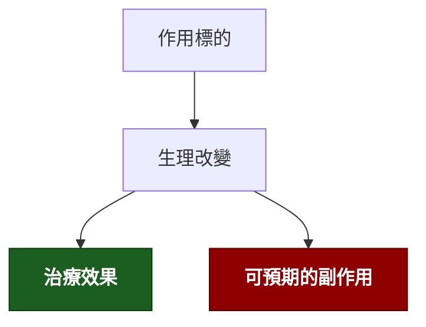

---
tags:
  - Clinical/Drug/
aliases:
created: "{{date:YYYY-MM-DD}}"
updated: "{{date:YYYY-MM-DD}}"
status: 骨架
source:
services:
cssclass: clinical-note
drug_class:
indication:
adverse_effect:
contraindication:
---

# {{title}} ｜ 學名 · 商品名 · 中文

> [!abstract] 一句話總覽
> 它屬於哪一類、靠什麼機轉、主要用來治什麼。

> [!tip] 開藥速查
> **常用劑量／途徑**：
> **腎／肝功能不良調整**：
> **絕對不可**：（沒有就寫「無」）

---

## 機轉 Mechanism

*作用在哪個標的？下游發生什麼事？副作用能不能從機轉推出來？*

> [!warning] 機轉圖用 `flowchart TD`
> `LR` 會愈接愈寬，在 Obsidian 裡右邊會被切掉。節點控制在 **10 個以內**、單行約 14 個中文字。

> [!todo] 📷 要插入圖片｜作用位置／受體示意
> **要能看到**：

> [!tip] 副作用多半是機轉的延伸
> 能從機轉推出來的副作用，不用背。

## 適應症 Indications

*短清單，直接列。這是本篇的核心內容之一。*

| 適應症 | 角色（第一線／替代／輔助） |
|---|---|
| [[]] |  |

## 劑量與用法

| 情境 | 劑量 | 途徑 | 頻次 |
|---|---|---|---|
| 一般成人 |  |  |  |
| 腎功能不良 |  |  |  |
| 肝功能不良 |  |  |  |

## 副作用 Adverse Effects

| 副作用 | 頻率 | 能從機轉推嗎 | 對應主訴 |
|---|---|---|---|
|  |  |  | [[]] |

## 交互作用與監測

| 併用什麼 | 會發生什麼 | 怎麼處理 |
|---|---|---|
|  |  |  |

**要追蹤的指標**：[[]]（Test）

## 特殊族群

*新進醫師最常在這裡踩雷。*

| 族群 | 注意事項 |
|---|---|
| 孕婦／哺乳 |  |
| 老年 |  |
| 腎衰竭／透析 |  |
| 兒童 |  |

## 禁忌與陷阱

> [!danger] 絕對不可
> | 情境 | 絕對不可 | 為什麼 | 該做什麼 |
> |---|---|---|---|
> |  |  |  |  |

> [!warning] 常見錯誤
> -

## 相關連結

- [[]] —
