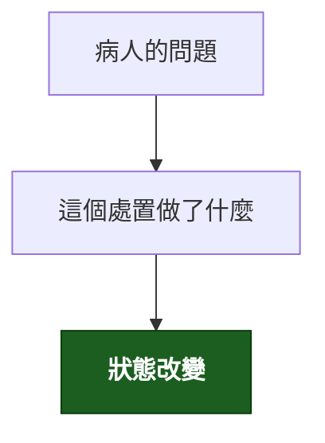

---
tags:
  - Clinical/Intervention/
aliases:
created: "{{date:YYYY-MM-DD}}"
updated: "{{date:YYYY-MM-DD}}"
status: 骨架
source:
services:
cssclass: clinical-note
indication:
contraindication:
complication:
---

# {{title}} ｜ 中文名 · English Name

> [!abstract] 一句話總覽
> 這個處置在做什麼、解決什麼問題、什麼時候該想到它。

> [!tip] 30 秒行動卡
> **最該記的適應症**：（口訣／短清單）
> **做之前一定要確認**：
> **絕對不可**：（沒有就寫「無」）

---

## 原理與目的

*它靠什麼物理／生理機制改變病人的狀態？*

> [!warning] 原理圖用 `flowchart TD`
> `LR` 會愈接愈寬，在 Obsidian 裡右邊會被切掉。節點控制在 **10 個以內**、單行約 14 個中文字。

> [!todo] 📷 要插入圖片｜原理示意
> **要能看到**：

> [!note] 與 Test 的分界
> 取得資訊 → 那是 Test；改變病人狀態 → 才是 Intervention。
> 同一個技術動作可能兩者都是（診斷性 vs 治療性腹腔穿刺），各寫一篇並互連。

## 適應症 Indications

*短清單，直接列。有口訣就寫口訣。*

| 適應症 | 判斷閾值／時機 |
|---|---|
| [[]] |  |

## 術前準備與評估

| 項目 | 內容 |
|---|---|
| 必查檢驗 | [[]] |
| 影像／定位 |  |
| 同意書與風險說明 |  |
| 停藥（抗凝／抗血小板） |  |

## 操作概要

*不是操作手冊，是「你要知道會發生什麼」的程度。**這一節一定要配圖**——只讀文字想像不出來。*

1.
2.
3.

> [!todo] 📷 要插入圖片｜定位／進路／器械擺位（**這張是必配**）
> **要能看到**：

## 併發症 Complications

| 併發症 | 何時出現 | 怎麼發現 | 怎麼處理 |
|---|---|---|---|
| [[]] |  |  |  |

## 術後監測

*接下來幾小時要盯什麼？什麼數字出現要叫人？*

| 要盯的 | 頻率 | 異常閾值 |
|---|---|---|
|  |  |  |

## 禁忌與陷阱

> [!danger] 絕對不可
> | 情境 | 絕對不可 | 為什麼 | 該做什麼 |
> |---|---|---|---|
> |  |  |  |  |

> [!warning] 常見錯誤
> -

## 相關連結

- [[]] —
