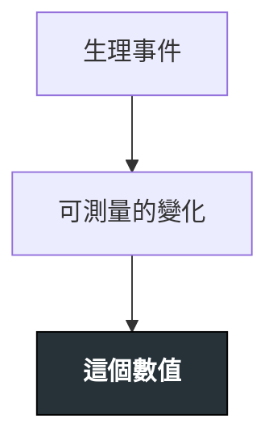

---
tags:
  - Clinical/Test/
aliases:
created: "{{date:YYYY-MM-DD}}"
updated: "{{date:YYYY-MM-DD}}"
status: 骨架
source:
services:
cssclass: clinical-note
modality: lab
compare_with:
---

# {{title}} ｜ 中文名 · English Name

> [!abstract] 一句話總覽
> 這個檢查在測什麼、代表什麼生理意義、什麼時候該想到它。

> [!tip] 判讀速查
> **正常範圍**：
> **決策切點**：
> **紅旗值**：（超過就要立刻處理）

---

## 原理 Principle

*它到底在量什麼？為什麼這個數字能反映那件事？*

> [!warning] 原理圖用 `flowchart TD`
> `LR` 會愈接愈寬，在 Obsidian 裡右邊會被切掉。節點控制在 **10 個以內**、單行約 14 個中文字。

> [!todo] 📷 要插入圖片｜原理／解剖示意
> **要能看到**：

> [!note] 這一節是本篇存在的理由
> Disease 與 Workup 頁只會寫「做這個檢查」與判讀結論；**原理只寫在這裡一次**。

## 什麼時候做

*寫「決策情境」，不要列疾病清單——那清單無上限，會爆炸。*

- 當你想回答「＿＿＿」這個問題時
- 當病人出現＿＿＿而你需要量化它時

> [!info] 反查
> 想知道「哪些疾病會用到我」→ 看右側 Backlinks 面板。

## 怎麼做 / 病人準備

| 項目 | 內容 |
|---|---|
| 檢體／部位 |  |
| 病人準備 |  |
| 時效 |  |

> [!todo] 📷 要插入圖片｜姿勢、定位、操作步驟
> **要能看到**：

## 判讀 Interpretation

| 結果 | 代表 | 下一步 |
|---|---|---|
| 升高 |  | [[]] |
| 降低 |  |  |
| 正常但臨床仍懷疑 |  |  |

> [!todo] 📷 要插入圖片｜判讀圖例：正常 vs 異常對照
> **要能看到**：

## 干擾與偽陽性

*這一節最常被跳過，也最常害人。*

| 會讓結果失真的因素 | 往哪個方向偏 |
|---|---|
|  |  |

## 與相關檢查的取捨

*什麼時候用它、什麼時候該用別的？*

| 檢查 | 優點 | 缺點 | 什麼時候選它 |
|---|---|---|---|
| 本篇 |  |  |  |
| [[]] |  |  |  |

## 禁忌與陷阱

> [!danger] 絕對不可
> | 情境 | 絕對不可 | 為什麼 | 該做什麼 |
> |---|---|---|---|
> |  |  |  |  |

> [!warning] 常見錯誤
> -

## 相關連結

- [[]] —
