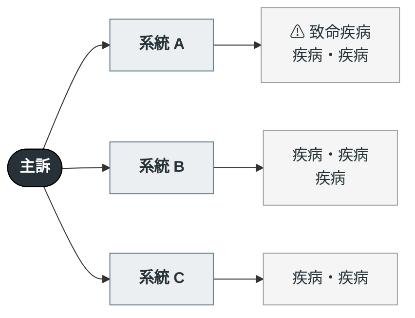

---
tags:
  - Clinical/Workup/
aliases:
created: "{{date:YYYY-MM-DD}}"
updated: "{{date:YYYY-MM-DD}}"
status: 骨架
source:
services:
cssclass: clinical-note
cant_miss:
differential:
key_tests:
---

# {{title}} ｜ 中文主訴 · English Complaint

> [!abstract] 一句話總覽
> 這個主訴最常見的原因是什麼、最怕的是什麼、第一步做什麼。

> [!danger] Can't-miss — 漏掉會死人
> 這一格永遠先讀。**沒排除完不准往下走。**
>
> | 不能漏 | 一眼線索 | 立刻做什麼排除 |
> |---|---|---|
> | [[]] |  |  |

> [!tip] 到床邊的前 5 分鐘
> **看**：（生命徵象、意識、外觀）
> **問**：（三個最關鍵的問題）
> **做**：（第一批 order）

---

## 鑑別架構圖

*先看骨架，再看細節。這張圖回答「可能性從哪幾個分支長出來」，不是「先做什麼再做什麼」。*
*分支用系統或機轉分類，務必 MECE。⚠ 標記漏掉會死人的。*

> [!warning] 圖的尺寸紀律——超過就會被切掉
> Obsidian 不會自動縮放 Mermaid，圖太寬會被截斷、太高會一眼看不完。硬性上限：
>
> | 項目 | 上限 |
> |---|---|
> | 節點總數 | **約 14 個** |
> | 層數 | **3 層**（主訴 → 系統 → 疾病群） |
> | 每個系統的末梢 | **合併成 1 個節點**，疾病用 `・` 隔開、` ` 換行 |
> | 單行字數 | 約 14 個中文字 |
>
> **分類樹用 `flowchart LR`**（寬度＝層數，好控制）；**機制／流程用 `flowchart TD`**（LR 會愈拉愈寬而被切掉）。

> [!note] 圖與表的分工
> Mermaid 節點裡**放不了 wikilink**。圖負責「一眼看到全貌」，下方表格負責「點進去」——不要在圖裡塞細節。

## 病史 History

*要問什麼？哪個答案會把鑑別往哪邊拉？*

| 問題 | 若為「是」→ 想到 |
|---|---|
|  | [[]] |

**一定不能漏問**：
- 用藥史（含最近新加的藥 → 藥物性可能）
- 過去病史／手術史
- TOCC：旅遊、職業、接觸、群聚

## 理學檢查 PE

*一定要做的是哪幾個？陽性代表什麼？*

| 要做的 PE | 陽性代表 |
|---|---|
|  | [[]] |

## 第一批檢查 Initial Workup

*現在就開什麼？等結果再開什麼？*

| 時機 | 檢查 | 想回答的問題 |
|---|---|---|
| 立刻 | [[]] |  |
| 次要 |  |  |

## 鑑別診斷

*完整清單，依「致命 → 常見 → 少見但要想到」分層。頂部的 can't-miss 是這張表第一層的濃縮。*

### 致命（can't-miss）

| 疾病 | 支持線索 | 排除方法 |
|---|---|---|
| [[]] |  |  |

### 常見

| 疾病 | 支持線索 | 排除方法 |
|---|---|---|
| [[]] |  |  |

### 少見但要想到

| 疾病 | 支持線索 | 排除方法 |
|---|---|---|
| [[]] |  |  |

## 處置分流 Disposition

*什麼情況收 ICU、收一般病房、可以回家？*

| 去向 | 條件 |
|---|---|
| ICU |  |
| 住院 |  |
| 門診追蹤／回家 |  |

## 禁忌與陷阱

> [!danger] 絕對不可
> | 情境 | 絕對不可 | 為什麼 | 該做什麼 |
> |---|---|---|---|
> |  |  |  |  |

> [!warning] 常見錯誤
> -

## 相關連結

- [[]] —
